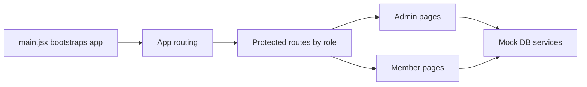

# StudioManager

<p align="left">
  <a href="https://react.dev" target="_blank" rel="noreferrer">
    
  </a>
  <a href="https://vite.dev" target="_blank" rel="noreferrer">
    
  </a>
  <a href="https://reactrouter.com" target="_blank" rel="noreferrer">
    
  </a>
  <a href="https://developer.mozilla.org/en-US/docs/Web/CSS" target="_blank" rel="noreferrer">
    
  </a>
  <a href="https://eslint.org" target="_blank" rel="noreferrer">
    
  </a>
</p>

A role-based React app for running a detailing studio, with:
- an **Admin portal** for operations (users, sales, inventory, summary metrics)
- a **Member portal** for customer workflows (bookings, support, shop, account settings)
- a local, seeded mock data layer backed by `localStorage`

## Quick Navigation
- [Tech Stack](#tech-stack)
- [What You Can Do](#what-you-can-do)
- [Interactive Role Walkthrough](#interactive-role-walkthrough)
- [Architecture](#architecture)
- [Project Structure](#project-structure)
- [Local Data Model](#local-data-model)
- [Default Login (Seed Data)](#default-login-seed-data)
- [Getting Started](#getting-started)
- [Available Scripts](#available-scripts)

## Tech Stack
- [React 19](https://react.dev)
- [Vite 7](https://vite.dev)
- [React Router DOM 7](https://reactrouter.com)
- [CSS Modules](https://github.com/css-modules/css-modules)
- [ESLint 9](https://eslint.org)


## What You Can Do
### Admin Features
- Dashboard summary metrics (users, revenue, check-ins, activity trends)
- User management (create, edit, delete)
- Sales management (record sales, view sales table)
- Inventory management (add/remove items, stock tracking)

### Member Features
- Member dashboard snapshot (spend, visits, upcoming bookings)
- Booking workflow (request, upcoming schedule, history)
- Shop experience (product catalog, category filters, cart estimate, service add-ons)
- Support desk (ticket submission, status, FAQ, contact channels)
- Account settings (profile, notifications, password update)

### Shared UI Primitives
- Reusable cards and metric cards (`Card`, `MetricCard`)
- Reusable form primitives (`FormField`, `SelectField`, `ToggleRow`, `PasswordField`, `AdminFormCard`)
- Stateful extracted panels (`BookingRequestPanel`, `SupportRequestPanel`, `SettingsSection`)

## Interactive Role Walkthrough
<details>
  <summary><strong>Admin Journey</strong></summary>

1. Sign in as an admin.
2. Open the dashboard for high-level metrics.
3. Manage users, record sales, and update inventory.
4. Track operational trends from summary cards and activity views.

</details>

<details>
  <summary><strong>Member Journey</strong></summary>

1. Sign in as a member.
2. Check spend/visit snapshot on the dashboard.
3. Create booking requests and review schedule/history.
4. Browse shop items, add add-ons, and submit support tickets.
5. Update profile, notification preferences, and password.

</details>

## Architecture
The app is split into clear layers:

1. **App bootstrap**
   - `src/main.jsx`
   - Seeds local data via `seedDB()` and mounts React.

2. **Routing and access control**
   - `src/App.jsx`
   - `src/pages/ProtectedRoute.jsx`
   - `src/contexts/AuthContext.jsx`
   - Routes are segmented by role (`admin`, `member`) and protected with role-aware guards.

3. **Layout and navigation**
   - `src/layouts/AppLayout.jsx`
   - `src/components/Header.jsx`
   - `src/components/Sidebar.jsx`
   - Shared shell wraps both admin and member page experiences.

4. **Feature pages**
   - Admin: `src/pages/AdminPages/*`
   - Member: `src/pages/MemberPages/*`
   - Refactors moved form state into extracted panel components for cleaner page boundaries.

5. **Service layer (mock DB + auth)**
   - `src/services/mockDbServices.js`
   - `src/services/mockAuth.js`
   - `src/services/mockData.js`
   - Encapsulates localStorage reads/writes, seeding, normalization, and dashboard aggregation helpers.



## Project Structure
```text
src/
  components/
  contexts/
  layouts/
  pages/
    AdminPages/
    MemberPages/
  services/
```

## Local Data Model
StudioManager is currently mock-data driven:
- data is seeded from `MOCK_DATA` on startup
- records persist in browser `localStorage`
- no external API or backend service is required for local development

To reset data, clear the app's localStorage in the browser and reload.

## Default Login (Seed Data)
The seeded data includes admin and member users. A default admin account:
- **Username:** `adminDude`
- **Email:** `admin@studio.local`
- **Password:** `admin123!!`

## Getting Started
1. Install dependencies:
   ```bash
   npm install
   ```
2. Start the development server:
   ```bash
   npm run dev
   ```
3. Run lint checks:
   ```bash
   npm run lint
   ```

## Available Scripts
- `npm run dev` - run Vite dev server
- `npm run build` - create production build
- `npm run lint` - run ESLint
- `npm run preview` - preview built app locally
